# From Revit to Robot: BIM-Driven Digital Twin for Autonomous Building Operations

<p align="center">
  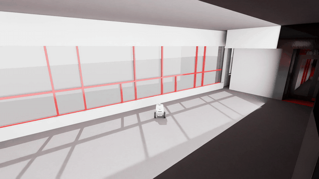
</p>
<p align="center"><sub>A simulated NVIDIA Nova Carter driving along a glass-walled corridor inside the Isaac Sim twin of the Kern Center (2× speed).</sub></p>

<p align="center">
  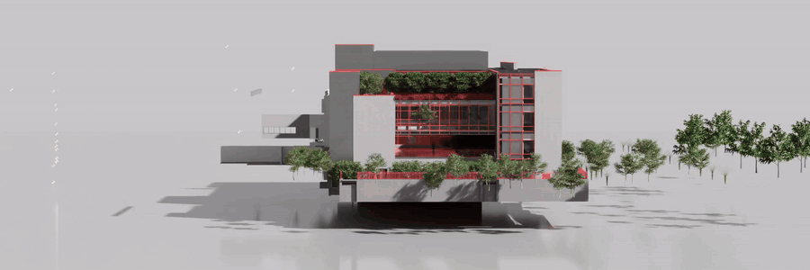
</p>
<p align="center"><sub>Camera orbit around the Kern Center digital twin in NVIDIA Isaac Sim. The building comes from the architects' Revit model.</sub></p>

**Train a building's security-patrol robot before the building exists.** We turn an architect's Revit model into a physics-accurate NVIDIA Isaac Sim digital twin. Inside it we generate auto-labeled synthetic camera/LiDAR data, fine-tune a vision-language model to spot safety anomalies, and drive a Nova Carter robot on planned patrol routes with ROS 2 Nav2.

Student research project at the Milwaukee School of Engineering (MSOE). The target is the **Robert D. Kern Engineering Innovation Center**, a 97,000 sq ft building that was still under construction during this work.

<p align="center">
  <a href="https://www.youtube.com/watch?v=CEd0eEXGTiU"></a>
</p>
<p align="center"><sub><b>Project video:</b> <a href="https://www.youtube.com/watch?v=CEd0eEXGTiU">Revit to Robot, MSOE Rosie Supercomputer Super Challenge 2026</a> (MSOE YouTube channel).</sub></p>

## Highlights

- **BIM → USD → Isaac Sim pipeline.** Turns the Revit 2024 model into a simulation-ready twin with collision geometry, articulated doors, and semantic labels.
- **Synthetic data with free labels.** Door open/closed and glass cracked/intact frames come out of the simulator already labeled, with domain randomization (lighting, viewpoint, door families, crack styles).
- **Fine-tuned VLM** (`Qwen/Qwen3-VL-2B-Instruct` + LoRA). Trained on synthetic renders only. **97.4% / 97.2%** on held-out *synthetic* door / glass frames. **93.0%** on 100 *real* door photos from an existing campus building, where the base model already scored 100% ([results](#results)).
- **DINOv2-based data curation.** Stratified k-means on DINOv2 embeddings picks a diverse, label-balanced training subset.
- **Autonomous patrol in the twin.** Occupancy maps → NVIDIA SWAGGER navigation graph → traveling-salesman door-inspection route → ROS 2 Nav2 drives a simulated Nova Carter with 360° LiDAR.
- **Runs headless at scale** on MSOE's **Rosie** supercomputer (SLURM; T4 and V100 GPUs).
- **Recognition:** Rosie Supercomputer Challenge 2026 finalist (5 of 27 teams) and Honorable Mention. Co-authored a paper published at MICS 2026.
  <!-- TODO(Adrian): add the MICS 2026 paper title + link, and a Rosie Challenge link if public. -->

---

## Demos

<p align="center">
  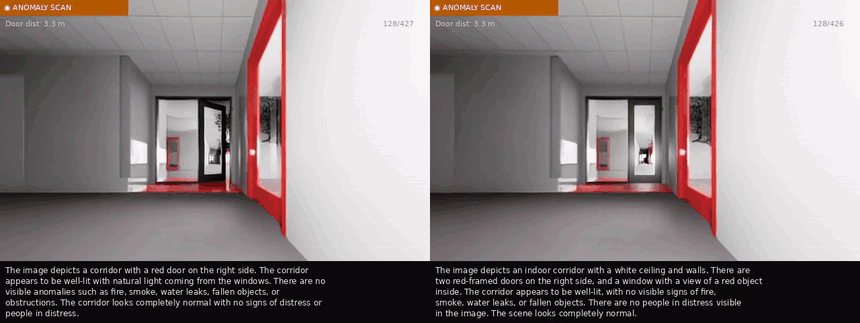
</p>
<p align="center"><sub><b>The VLM at work.</b> Two runs of the robot's camera approaching the same door, open on the left and closed on the right. First the base model describes the scene and checks for hazards. Closer to the door, the fine-tuned model labels it: <b>OPEN</b> (left), <b>CLOSED</b> (right). Simulated images; this clip uses the earlier Qwen2-VL version of the model.</sub></p>

<table>
  <tr>
    <td width="50%">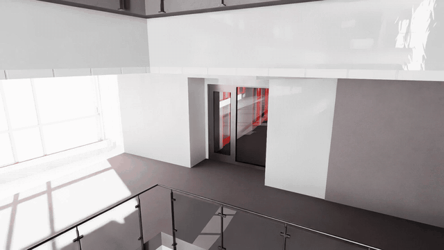</td>
    <td width="50%">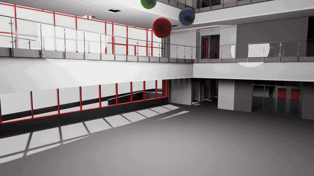</td>
  </tr>
  <tr>
    <td><sub><b>Articulated doors.</b> A door from the Revit model swinging on its hinge in the twin.</sub></td>
    <td><sub><b>Physics check.</b> Balls dropped onto the twin's ground floor land, bounce, and settle.</sub></td>
  </tr>
  <tr>
    <td>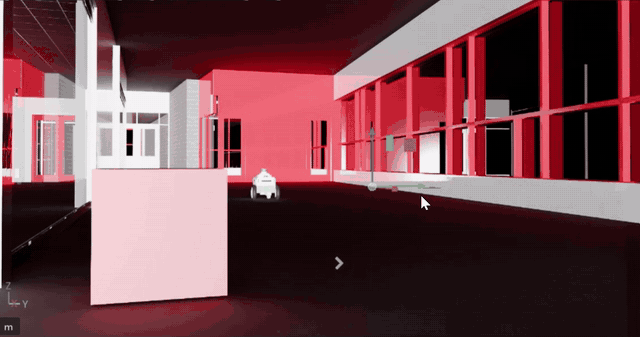</td>
    <td>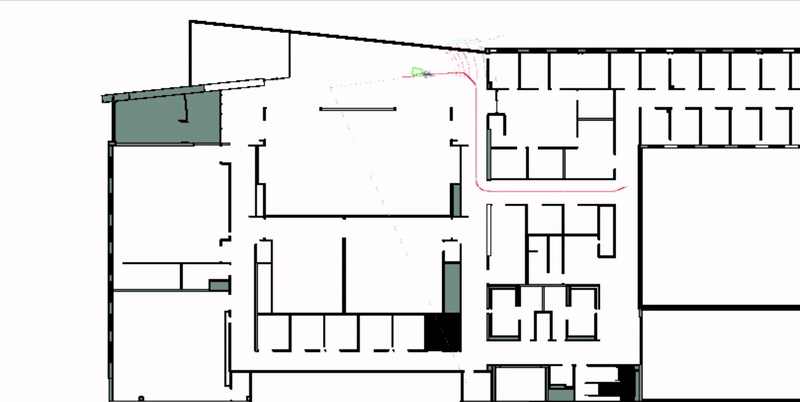</td>
  </tr>
  <tr>
    <td><sub><b>Robot in the twin.</b> Nova Carter driving past a box obstacle, live in the Isaac Sim viewport (1.5× speed).</sub></td>
    <td><sub><b>Costmap navigation.</b> The robot (green) follows its planned path (red) across a floor's occupancy map (4× speed).</sub></td>
  </tr>
  <tr>
    <td>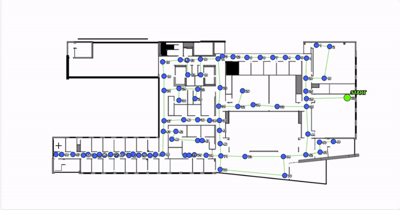</td>
    <td>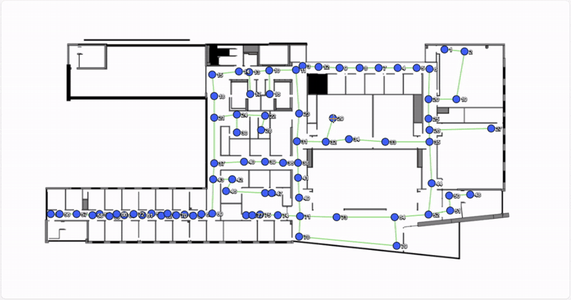</td>
  </tr>
  <tr>
    <td><sub><b>Dijkstra routing.</b> Shortest path (yellow) between a START and an END node on the auto-generated navigation graph (3× speed).</sub></td>
    <td><sub><b>Patrol planning.</b> The navigation graph becomes a numbered traveling-salesman tour from a START node (3× speed).</sub></td>
  </tr>
</table>

<!-- TODO(Adrian): optionally link full-length "CostMapNavigation.mp4", "Djikstras Algo.mp4", "TSP-Video.mp4" if uploaded. -->

---

## How it works

<p align="center">
  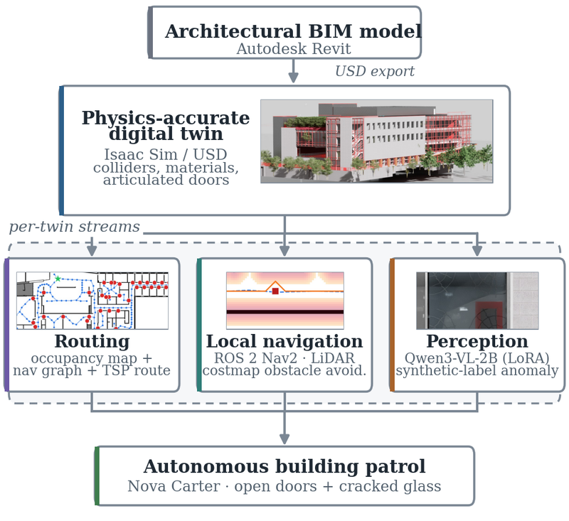
</p>

### 1. Build the twin

- **Revit to USD.** MSOE's architects gave us the Kern Center model in Revit 2024. We export it to USD and keep only what the robot needs: walls, floors, doors, stairs. Then we add collision geometry and physics materials. See [`revit_to_usd.py`](revit_to_usd.py) and [`assets/environments/InnovationCenter/`](assets/environments/InnovationCenter/README.md).
- **Doors that move.** Each hinged door becomes a revolute joint. The robot sees doors at many angles, and every frame is labeled automatically.
- **Occupancy maps.** We ray-trace each floor of the twin to get the grid maps Nav2 uses. See [`floorplan_vision/`](floorplan_vision/README.md).

<p align="center">
  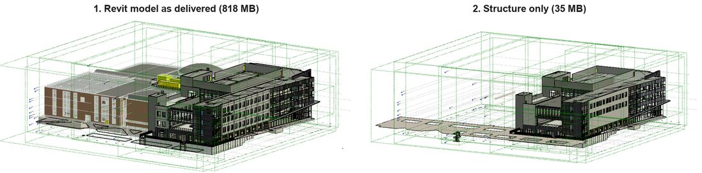
</p>
<p align="center"><sub>The Revit file came with the old science building, HVAC, electrical, plumbing, and furniture. We kept walls, floors, ceilings, stairs, and railings, which cut the file from 818 MB to 35 MB.</sub></p>

<details>
<summary><b>How we made the twin behave like a building</b></summary>

<br>

Our first import had no physics, so the robot fell straight through the floor.

<p align="center">
  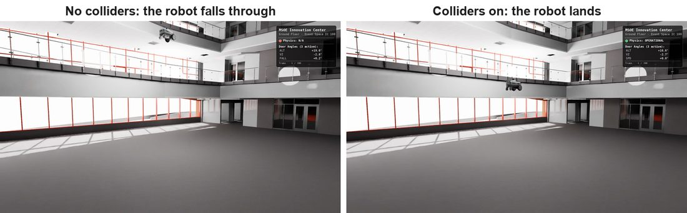
</p>

The fix is a pipeline that sorts all 8,268 Revit elements by type. Walls, floors, and ceilings get static triangle-mesh colliders. Doors get convex-hull colliders and a revolute joint each.

<p align="center">
  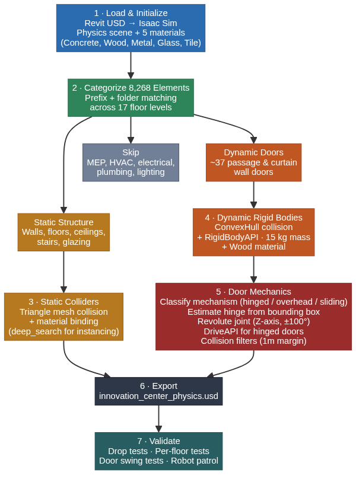
  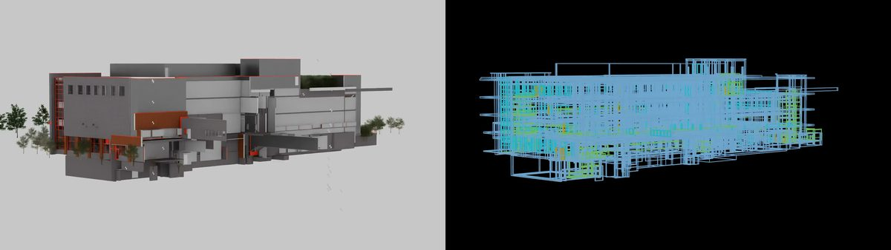
</p>
<p align="center"><sub>Collision view: blue is structure, cyan is glazing, orange is doors, green is stairs.</sub></p>

Revit doesn't say which edge of a door is the hinge. With the default pivot, doors swung through their own frames. We compute the hinge edge from each door's geometry instead.

<p align="center">
  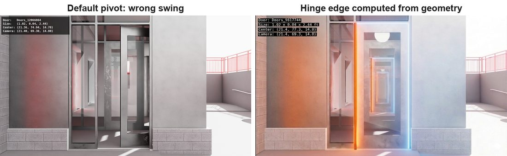
</p>

</details>

<p align="center">
  
</p>
<p align="center"><sub>Ray-tracing floor 1 to build its occupancy map. Dark cells are walls; light cells are open floor.</sub></p>

<details>
<summary><b>All four floors, and the bug that drove the robot into walls</b></summary>

<br>

<p align="center">
  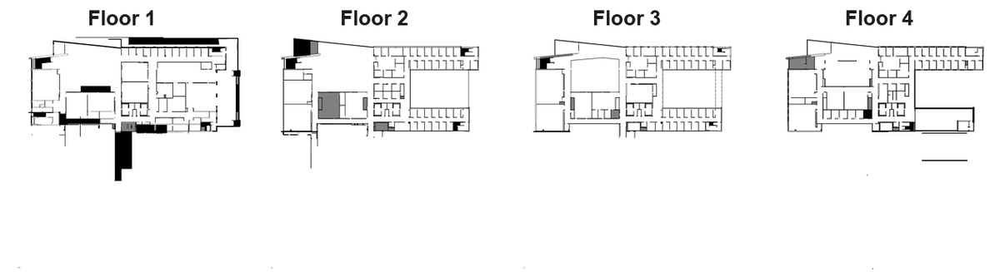
</p>

Nav2 kept driving the robot into walls. Our generator writes row 0 of the map image as the world's lowest y, and Nav2 reads row 0 as the highest. Nav2 planned on a vertically mirrored map, where 271,056 of 1,683,278 cells (16.1%) disagree with the building. Making both sides agree on row 0 fixed it.

<p align="center">
  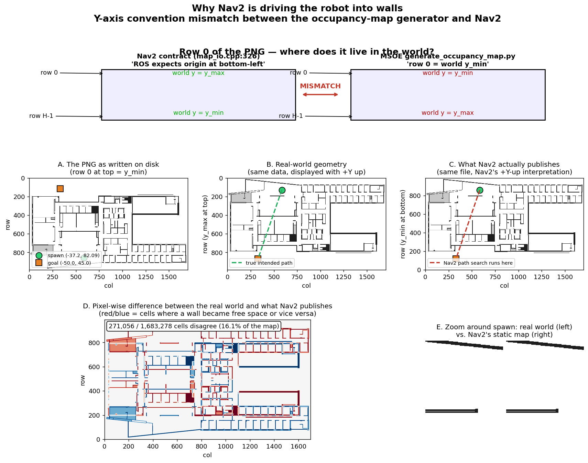
</p>

</details>

### 2. Teach a VLM to spot problems

- **Synthetic frames.** The robot's camera records doors and glass panels under random lighting and viewpoints. Cracked glass comes from swapping generated crack materials onto random panels. See [`SyntheticDataGen/cracked_glass/`](SyntheticDataGen/cracked_glass/README.md).
- **Pick a varied training set.** We embed every frame with DINOv2 and run k-means inside each label group. Keeping the frame closest to each cluster center gives varied images and an exact 50/50 class split. See [`curate_diversity.py`](SyntheticDataGen/cracked_glass/curate_diversity.py).
- **Fine-tune.** We started with Qwen2-VL and moved to **Qwen3-VL-2B-Instruct**, which had the best zero-shot score of the small VLMs we tried. LoRA plus the vision projector trains about 1.6% of the weights. One model answers one question with four answers: door open, door closed, glass cracked, glass intact. See [`vlm/qwen3vl_unified_lora_v4/`](vlm/qwen3vl_unified_lora_v4/USAGE.md).

<p align="center">
  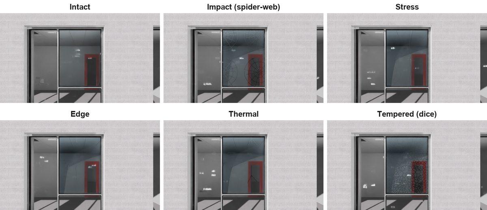
</p>
<p align="center"><sub>One glass panel, intact and with five crack types. The simulator writes the label at render time, so every frame comes labeled.</sub></p>

<details>
<summary><b>How the labels and the training set are built</b></summary>

<br>

**Door labels come from the joint.** Each door is a revolute joint, so we read its angle θ from the simulator and threshold it:

```math
y_{door} = \begin{cases} \text{closed} & \theta \le 5^\circ \\ \text{open} & \theta > 5^\circ \end{cases}
```

<p align="center">
  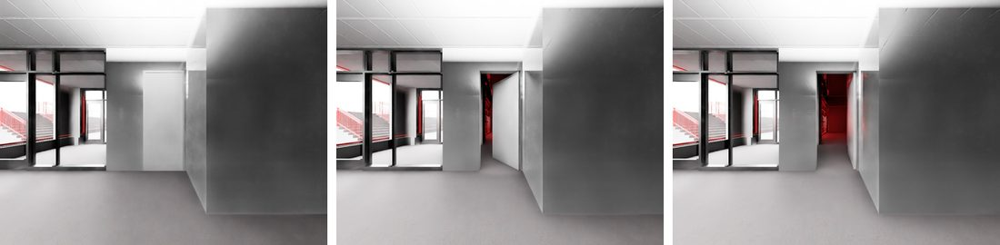
</p>

**Glass is randomized on seven axes:** 13 panels, 5 lighting presets, 4 glass states, 3 camera angles, 3 distances, 3 crack textures, and 4 camera heights.

**Picking a varied subset.** Frames from one camera sweep look almost identical, so we train on a varied subset. We embed each frame with DINOv2 (768-d, L2-normalized) and run k-means separately inside each label group *g*:

```math
\min_{\mu_1,\dots,\mu_k} \sum_{c=1}^{k} \sum_{i \in C_c} \lVert z_i - \mu_c \rVert^2, \qquad i^*_c = \arg\min_{i \in C_c} \lVert z_i - \mu_c \rVert
```

We keep frame $i^*_c$, the one nearest each centroid. Because every $z_i$ has unit length, $\lVert a-b \rVert^2 = 2 - 2\cos(a,b)$, so this is k-means on cosine distance. Running it per label group gives an exact 50/50 class split.

**What fine-tuning changes.** LoRA freezes each weight matrix $W_0$ and learns a low-rank update on the attention projections `q_proj` and `v_proj`:

```math
W = W_0 + \frac{\alpha}{r} BA, \qquad B \in \mathbb{R}^{d \times r},\ A \in \mathbb{R}^{r \times k},\ r = 16,\ \alpha = 32
```

We also train the full vision projector, the layer that turns image patches into tokens the language model reads. It was built for real photos, and without adapting it the LLM gets no useful signal from synthetic frames. Together that is about 2.2M LoRA weights plus 34M projector weights, 1.62% of the model.

</details>

### 3. Patrol

- **Why.** Campus security officers walk the halls to check that doors are locked and glass is intact. MSOE Public Safety told us these two checks matter most.
- **Robot.** A simulated **NVIDIA Nova Carter** ("ROSCOE") with 360° LiDAR and a camera.
- **Route.** NVIDIA SWAGGER builds a navigation graph on each floor map. The graph node closest to each door becomes a stop. Dijkstra gives the walking distance between every pair of stops. A traveling-salesman tour visits all of them: greedy nearest-neighbor, then 2-opt, best of 10 random starts. See [`floorplan_vision/visualize_door_tsp.py`](floorplan_vision/visualize_door_tsp.py).
- **Driving.** **ROS 2 Nav2** follows the route and steers around obstacles using LiDAR. See [`navigation/`](navigation/README.md). An earlier version used a reinforcement-learning policy. We switched to Nav2 because it was quicker to make reliable. The RL code is archived in [`training/`](training/) and on the `archive/rl-building-finetune` branch.
- **Goal.** MSOE Public Safety estimated that automating routine patrols could save about **3,000 officer-hours a year**.
  <!-- TODO(Adrian): confirm the ~3,000 officer-hours/yr figure and how it was derived. It is not documented in this repo. -->

<p align="center">
  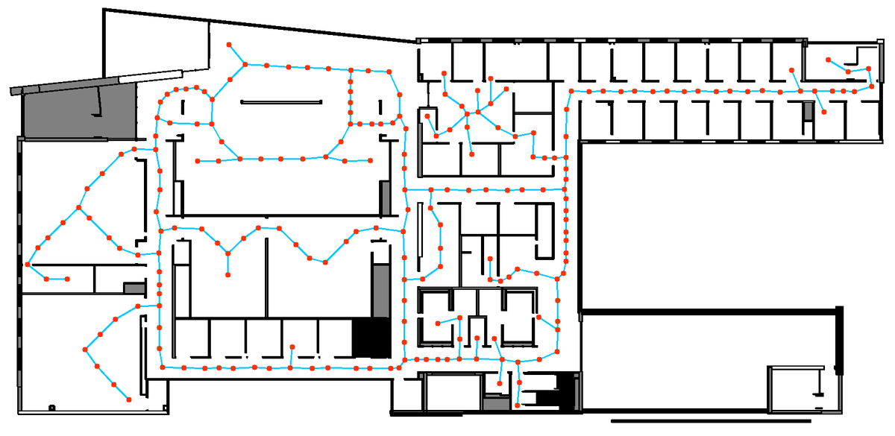
</p>
<p align="center"><sub>Floor 4 of the Kern Center: occupancy map with the auto-generated navigation graph (red nodes, blue edges).</sub></p>

<p align="center">
  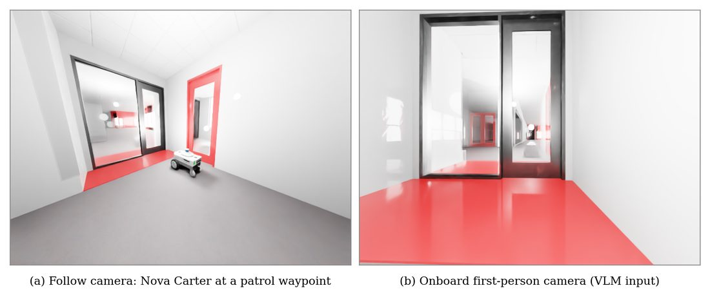
</p>
<p align="center"><sub>At a patrol stop. Left: a follow camera. Right: what the robot's camera sees, which is the frame the VLM classifies.</sub></p>

<details>
<summary><b>How the route and the driving work</b></summary>

<br>

**The tour.** With $D(a,b)$ the Dijkstra walking distance on the nav graph, the patrol looks for the order $\pi$ of door stops that minimizes total walking distance:

```math
\min_{\pi} \sum_{t=1}^{n-1} D(\pi_t, \pi_{t+1})
```

Exact TSP is too slow to rerun per floor, so we build a greedy nearest-neighbor tour and improve it with 2-opt. 2-opt reverses the stretch between stops *b* and *c* whenever

```math
D(a,b) + D(c,d) > D(a,c) + D(b,d)
```

and repeats until no swap helps. We keep the best of 10 random starts.

**Seeing obstacles.** Nav2 builds its local costmap from the 360° LiDAR, so a box or a person that isn't in the building model still gets avoided.

<p align="center">
  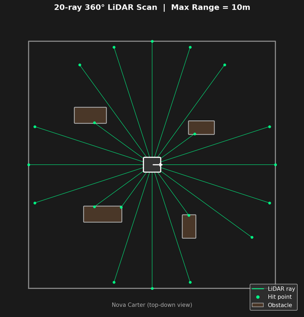
</p>

</details>

---

## Results

> **Read this first:** the first three rows are **simulated (synthetic) images**. The real-world row is a small 100-photo door test. Navigation results have not been tabulated yet.

Qwen3-VL-2B-Instruct, before (zero-shot) and after fine-tuning:

| Test set | n | Zero-shot | Fine-tuned | Change |
|---|---|---|---|---|
| Door, held-out frames (**synthetic**) | 4,472 | 74.9% | **97.4%** | +22.5 |
| Glass, held-out frames (**synthetic**) | 810 | 37.5% | **97.2%** | +59.7 |
| Door, unseen door instance / swing (**synthetic**) | 7,776 | 84.1% | **90.2%** | +6.1 |
| Real-world door photos (Diercks Hall, MSOE) | 100 | 100.0% | 93.0% | −7.0 |

- **Fine-tuning fixed what the base model couldn't do.** Cracked vs. intact glass went from 37.5% to 97.2%. Synthetic door frames went from 74.9% to 97.4%.
- **On real door photos it lost ground.** The base model already got all 100 right. The fine-tuned model got 93: every closed door right, 88.3% of open doors. Training only on synthetic images cost some accuracy on this easy real set. Closing that gap is the first item under [What's next](#whats-next).
- Diercks Hall is an existing MSOE building from the same architect, with the same design language.

<p align="center">
  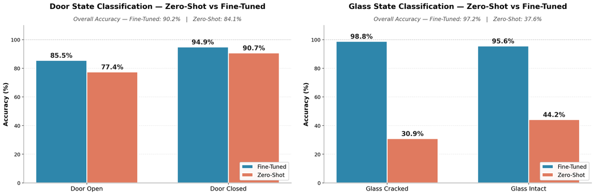
</p>
<p align="center"><sub>Zero-shot vs. fine-tuned. Left: door state on the unseen-door test. Right: cracked vs. intact glass, where the base model scored below chance.</sub></p>

<p align="center">
  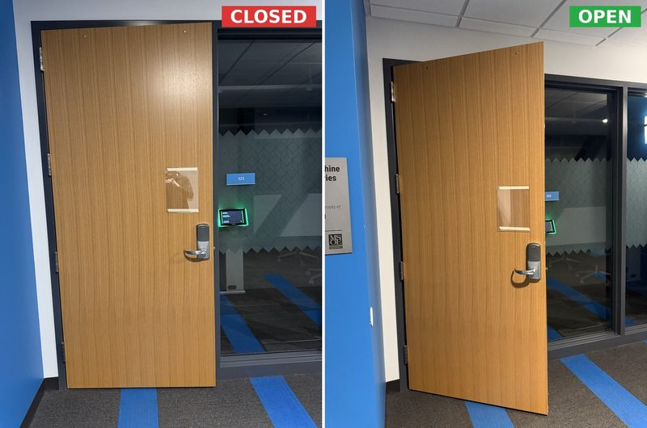
</p>
<p align="center"><sub>A door from the 100-photo real-world test in Diercks Hall, closed and open.</sub></p>

<details>
<summary><b>Confusion matrices and per-door accuracy</b></summary>

<br>

<p align="center">
  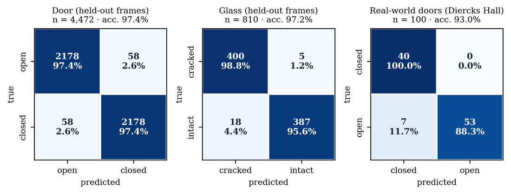
</p>

On real doors every miss is the same kind: an open door called closed (7 of 60). The model never calls a closed door open.

<p align="center">
  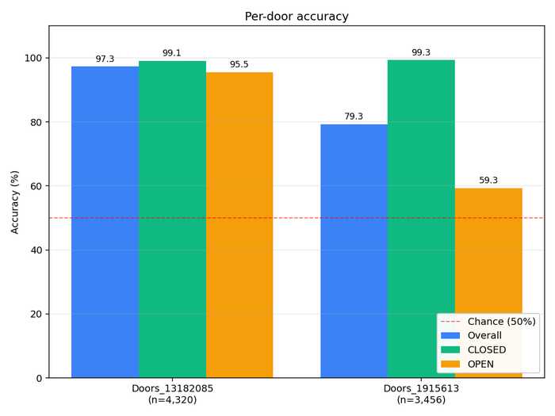
</p>

</details>

**Picking the base model.** We compared six small open VLMs zero-shot on synthetic door frames. None was usable as-is; Qwen3-VL-2B was the best and the smallest:

| Model | Params | Zero-shot accuracy |
|---|---|---|
| **Qwen3-VL-2B-Instruct** | 2B | **69.3%** |
| Qwen2.5-VL-7B-Instruct\* | 7B | 68.7% |
| Qwen2.5-VL-3B-Instruct | 3B | 64.9% |
| InternVL3-2B | 2B | 62.9% |
| Qwen2-VL-2B-Instruct | 2B | 62.1% |
| SmolVLM2-2.2B-Instruct\* | 2.2B | 62.1% |

<sub>\*Evaluated on the brighter-lighting subset only. This comparison used a different synthetic door set than the table above, so the Qwen3-VL numbers differ.</sub>

Raw results: `data/*.json` on the `tanner_vlm` branch (`eval_baseline_unified.json`, `holdout_eval_qwen3vl_2b_unified_v4_*.json`, `dh_doors_eval_qwen3vl_2b_unified_v4_*.json`).

- Scale: the pipeline was applied to a six-building digital campus, using over 3,500 GPU jobs and about 2,000 GPU-hours on Rosie.
<!-- TODO(Adrian): add Nav2 patrol metrics (route completion, collisions, time per tour) once tabulated. -->

---

## What didn't work

Each of these changed the design.

- **A one-door dataset made the model memorize that door.** Our first dataset used a single door from a single Revit family. The model scored high on it and **0%** on a door it had never seen: it had learned that door's look, not "open vs. closed". We rebuilt the data across 8 doors and several door families, randomized lighting and viewpoint, and held whole doors out for testing. On an unseen door the current model scores 90.2%.
- **The base model said OPEN every time.** Zero-shot Qwen2-VL labeled every synthetic door open: 0% on closed doors, 100% on open ones. It was trained on real photos, and our renders' lighting and textures gave it nothing to go on, so it fell back on one answer. After fine-tuning it separates the two states (see [Results](#results)).

<p align="center">
  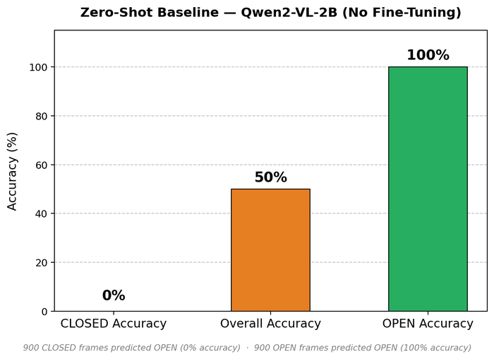
  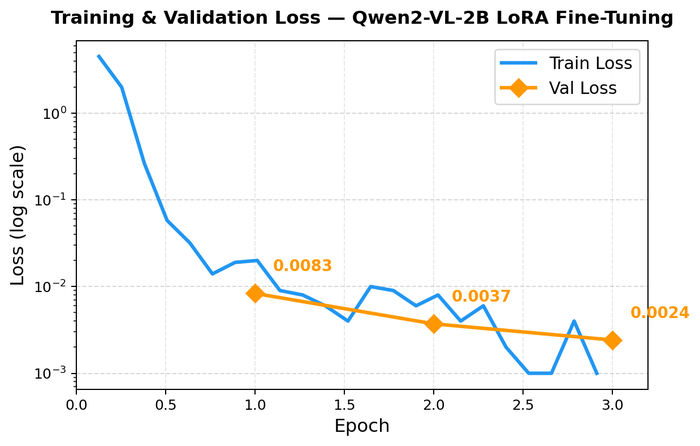
</p>
<p align="center"><sub>Left: zero-shot Qwen2-VL calls every door open. Right: train and validation loss for its LoRA fine-tune (3 epochs, log scale).</sub></p>

- **The saved model reloaded as the base model.** PEFT's default save keeps the LoRA weights but drops the trained vision projector unless it's listed in `modules_to_save`. The reloaded model looked fine and scored like the untrained baseline. The trainable projector weights also had to be cast to fp32, or mixed-precision gradient scaling failed.
- **The robot fell through the floor, and doors swung through walls.** The first import had no colliders and no hinge information. See [How we made the twin behave like a building](#1-build-the-twin).
- **Nav2 drove into walls.** A Y-axis convention mismatch mirrored the map (16.1% of cells wrong). See the occupancy-map details in [Build the twin](#1-build-the-twin).
- **Synthetic-only training cost accuracy on real doors.** The base model got 100 of 100 real Diercks Hall photos right; the fine-tuned model got 93. See [What's next](#whats-next).

### The reinforcement-learning attempt

Before Nav2, we tried to teach the robot to drive itself with reinforcement learning. The plan: train a policy in Isaac Lab on Rosie, move it into the BIM building, then onto the real Nova Carter. We completed 15 training runs on Rosie. The policy learned to head toward a goal but never learned to get around clutter reliably, so it never made it into the building. We dropped it for Nav2.

**Setup.** PPO (Stable-Baselines3, a 2 × 256 MLP) with 256 parallel environments on one T4 GPU, at 12 control steps a second. The robot sees 26 numbers: 20 LiDAR distances, the goal's position and heading, and its own speed and turn rate. It outputs a forward speed and a turn rate.

**First try: one cluttered room.** A 10 m × 10 m room with 7 furniture pieces in random spots, trained for 131M steps (about 10.5 hours). The policy passed **none** of our 6 test scenarios.

**Second try: a curriculum.** We rewrote the reward and trained in three stages: an open room, then 3 obstacles, then 7. Each new stage knocked the reward down, and the policy had to recover.

<p align="center">
  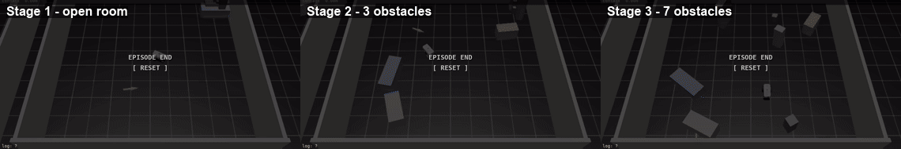
</p>

<p align="center">
  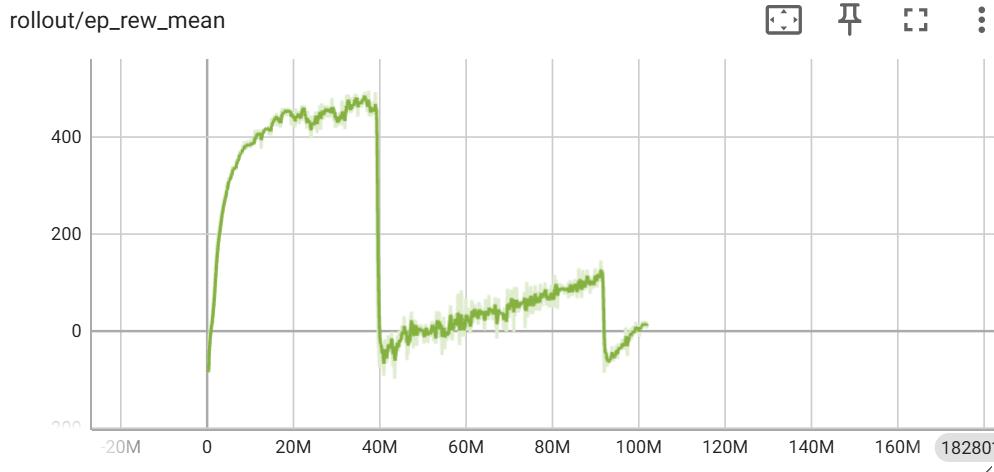
</p>
<p align="center"><sub>Mean episode reward. The two cliffs at about 40M and 92M steps are curriculum stage changes. At 102M steps (14.6 hours) the policy was still learning stage 3.</sub></p>

The best checkpoint on the same 6 scenarios:

| Scenario | Difficulty | Goals reached | Final distance | Collisions | Passed |
|---|---|---|---|---|---|
| Open run | Easy | 1/1 | 0.73 m | 0 | ✅ |
| Obstacle between | Medium | 0/1 | 4.70 m | 0 | ❌ |
| Narrow gap | Med-hard | 1/1 | 0.72 m | 0 | ✅ |
| Goal behind furniture | Hard | 0/1 | 0.97 m | 269 | ❌ |
| Cluttered room | Hard | 0/1 | 7.24 m | 320 | ❌ |
| Full patrol | Hard | 3/6 | 1.99 m | 1,032 | ❌ |

It drives toward open goals and threads a clear gap. With furniture in the way, it pushes into it. A patrol robot that hits something more than a thousand times on one route can't go near a real hallway. Nav2 plans around whatever the LiDAR costmap shows, so we switched the patrol to Nav2.

<details>
<summary><b>The reward, the drive equations, and what we learned designing them</b></summary>

<br>

The policy outputs a linear velocity $v$ and angular velocity $\omega$. A differential-drive action turns them into wheel speeds, with wheel base $b = 0.4$ m and wheel radius $r = 0.14$ m:

```math
v_L = \frac{v - \omega b/2}{r}, \qquad v_R = \frac{v + \omega b/2}{r}
```

The second-try reward per step, with $d$ the distance to the goal:

```math
R = 3.0\,(d_{prev} - d_{cur}) + 1.0\,\bigl(1 - \tanh(d/0.3)\bigr) - 0.05 - 2.0\,\max(0, -v_{fwd}) + 100\,\mathbb{1}[d < 0.75\,\text{m}] - 10\,\mathbb{1}[F_{contact} > 1\,\text{N}]
```

Progress toward the goal earns reward, the tanh term pulls the robot in on the final approach, and the small constant penalty stops it from circling. Driving backward and touching anything cost reward, and arrival pays a large one-time bonus.

Choices that came from failed runs:

- **Collisions cost reward but don't end the episode.** Ending on collision caused a death spiral: a robot that spawned next to furniture crashed at once and never collected enough experience to learn.
- **No heading reward.** A "face the goal" term punishes the right move when the robot has to turn away from the goal to get around an obstacle. The robot learns heading from the distance terms instead.
- **Contact sensor, not LiDAR, for collisions.** The LiDAR sits 0.36 m behind the bumper, so a LiDAR threshold missed real hits. A force sensor on the chassis catches contact from any side.

<p align="center">
  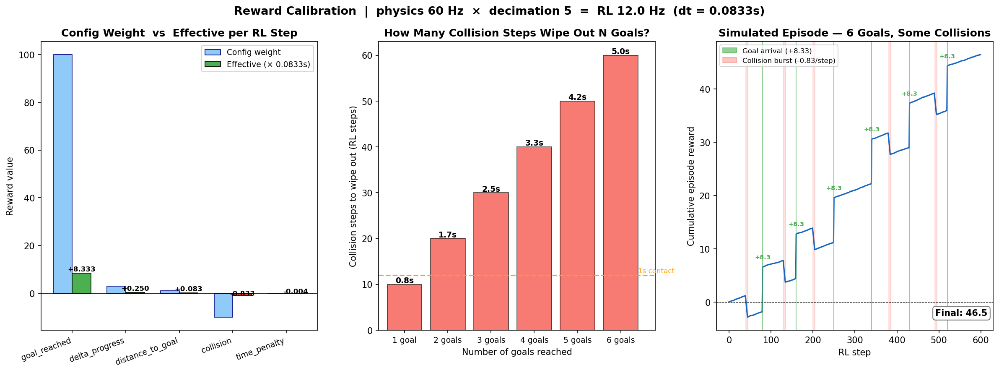
</p>

The code is archived in [`training/`](training/) and on the `archive/rl-building-finetune` branch.

</details>

---

## Team

MSOE student research group, led by **Adrian Manchado** through the MSOE AI Club.

Adrian Manchado (lead) · Owen Pacetti · Steven Thomas · Joseph Loduca · Nicolas Picha · Tanner Cellio · Diego Gonzalo · Delsoro Some

Built in coordination with MSOE's Public Safety Office, on MSOE's Rosie supercomputer.
<!-- TODO(Adrian): add a faculty advisor name, if you want to credit one. -->

---

## What's next

- **Close the real-photo gap.** Mix a small set of real photos into training, or keep the base model's answer when it is confident, so fine-tuning stops costing accuracy on real doors.
- **Sim-to-real on a physical Nova Carter.** Run the same SWAGGER + TSP + Nav2 patrol on real hardware, supervised by Public Safety.
- **Wider real-image validation.** Test the VLM on more real photos: cracked/intact glass (not yet tested on real images), more buildings, and harder lighting.
- **Navigation metrics.** Report route-completion and obstacle-avoidance results for Nav2 in the twin.
- **More anomaly types.** Hallway obstructions and irregular room states.
- **The Kern Center itself.** Re-run the pipeline once the building opens, and compare twin and real data.

---

## Repository map

```
revit_to_usd.py               Revit/IFC → USD conversion entry point
assets/environments/          Occupancy maps, nav graphs, environment notes
floorplan_vision/             Occupancy maps, auto nav graph, door → node mapping, TSP visuals
navigation/                   ROS 2 Nav2 package: params, launch, orchestrator, TSP demo recording
SyntheticDataGen/             Cracked-glass synthetic data + DINOv2 curation
simulations/                  Isaac Sim scenes: environment checks, robot + door data collection
vlm/                          Fine-tuned Qwen3-VL LoRA adapter card + usage
training/                     Archived RL navigation experiments (superseded by Nav2)
sim_utils/                    Shared helpers (follow camera, ffmpeg video capture)
docs/                         Pipeline notes; docs/media/ holds the demo GIFs above
DEVELOPMENT.md                Developer guide: Isaac Sim on Rosie, WebRTC streaming
scripts/                      Shell scripts: slurm/ (sbatch jobs), run/ (launchers), setup/, tests/. See scripts/README.md
```

> The 3D building models (`.usd`) are not published in this repo. The code expects them under `assets/environments/`; ask the team for access.

An early 10-second demo (Nova Carter in the stock Isaac Sim hospital scene, from before the Kern Center twin) is at [`assets/demos/hospital_follow_cam_10s.mp4`](assets/demos/hospital_follow_cam_10s.mp4).

---

## Developing

Everything runs on NVIDIA Isaac Sim 5.1, headless on MSOE's Rosie cluster (SLURM) or streamed to a local GUI over WebRTC.
Setup, job submission, streaming, and troubleshooting are in **[DEVELOPMENT.md](DEVELOPMENT.md)**.

