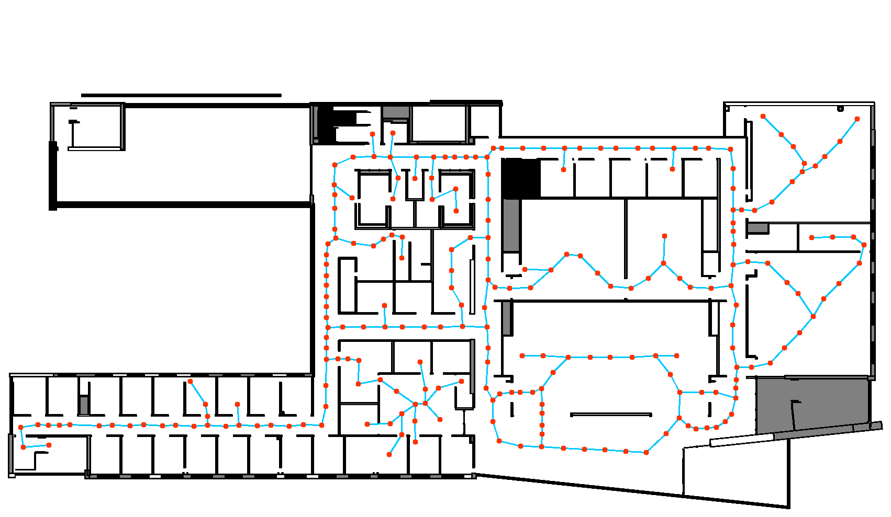

# From Revit to Robot: BIM-Driven Digital Twin for Autonomous Building Operations

**Train a building's security-patrol robot before the building exists.** We turn an architect's Revit model into a physics-accurate NVIDIA Isaac Sim digital twin. Inside it we generate auto-labeled synthetic camera/LiDAR data, fine-tune a vision-language model to spot safety anomalies, and drive a Nova Carter robot on planned patrol routes with ROS 2 Nav2.

Student research project at the Milwaukee School of Engineering (MSOE). The target is the **Robert D. Kern Engineering Innovation Center**, a 97,000 sq ft building that was still under construction during this work.

## Highlights

- **BIM → USD → Isaac Sim pipeline.** Turns the Revit 2024 model into a simulation-ready twin with collision geometry, articulated doors, and semantic labels.
- **Synthetic data with free labels.** Door open/closed and glass cracked/intact frames come out of the simulator already labeled, with domain randomization (lighting, viewpoint, door families, crack styles).
- **Fine-tuned VLM** (`Qwen/Qwen3-VL-2B-Instruct` + LoRA). Trained on synthetic renders only. **97.4% / 97.2%** on held-out *synthetic* door / glass frames. **93.0%** on 100 *real* door photos from an existing campus building ([results](#results)).
- **DINOv2-based data curation.** Stratified k-means on DINOv2 embeddings picks a diverse, label-balanced training subset.
- **Autonomous patrol in the twin.** Occupancy maps → NVIDIA SWAGGER navigation graph → traveling-salesman door-inspection route → ROS 2 Nav2 drives a simulated Nova Carter with 360° LiDAR.
- **Runs headless at scale** on MSOE's **Rosie** supercomputer (SLURM; T4 and V100 GPUs).
- **Recognition:** Rosie Supercomputer Challenge 2026 finalist (5 of 27 teams) and Honorable Mention. Co-authored a paper published at MICS 2026.
  <!-- TODO(Adrian): add the MICS 2026 paper title + link, and a Rosie Challenge link if public. -->

---

## The pipeline: first mile → middle mile → last mile

```
 FIRST MILE: sensing before the building exists
   Revit 2024 BIM ──► USD ──► NVIDIA Isaac Sim digital twin
        collision + physics materials, articulated doors, semantic labels
        synthetic onboard camera + LiDAR, ray-traced occupancy maps
                               │
 MIDDLE MILE: models
   DINOv2 embeddings ──► diversity-curated, label-balanced training set
   Qwen3-VL-2B-Instruct + LoRA ──► "door open / closed / glass cracked / intact"
                               │
 LAST MILE: so what
   SWAGGER nav graph + TSP route ──► ROS 2 Nav2 (LiDAR) ──► Nova Carter patrol
   flags open/unsecured doors and cracked glass for campus Public Safety
```

### First mile: sensing before the building exists

- **BIM to USD.** MSOE's architects supplied the Kern Center model in Revit 2024. It is exported to USD and cleaned up for simulation: only structural parts are kept (walls, floors, doors, stairs), with collision geometry and physics materials added. See [`revit_to_usd.py`](revit_to_usd.py) and [`assets/environments/InnovationCenter/`](assets/environments/InnovationCenter/README.md).
- **Working doors.** Hinged doors become revolute joints, so the robot sees doors in many open/closed states. Every frame gets an exact label for free.
- **Occupancy maps.** Ray-tracing the twin floor by floor gives Nav2-ready occupancy grids. See [`floorplan_vision/`](floorplan_vision/README.md).
- **Synthetic sensor data.** Onboard-camera frames of doors and glass panels, with lighting and viewpoint randomization. Cracked glass is made by swapping procedurally generated crack materials onto random panels. See [`SyntheticDataGen/cracked_glass/`](SyntheticDataGen/cracked_glass/README.md) and [`docs/cracked-glass-pipeline.md`](docs/cracked-glass-pipeline.md).

<p align="center">
  
  
</p>
<p align="center"><sub>Left: synthetic cracked-glass render. Right: floor-4 occupancy map with the auto-generated navigation graph.</sub></p>

### Middle mile: models

- **Data curation with DINOv2.** Frames are embedded with DINOv2, then k-means runs inside each (label, panel/door) bucket. The frame nearest each centroid is kept, giving visual diversity with an exact 50/50 class balance. See [`curate_diversity.py`](SyntheticDataGen/cracked_glass/curate_diversity.py) and [`embed_train_frames.py`](SyntheticDataGen/cracked_glass/embed_train_frames.py).
- **VLM fine-tuning.** We first tried Qwen2-VL, then moved to **Qwen3-VL-2B-Instruct**, the strongest zero-shot baseline among the small VLMs we compared. We train it with LoRA plus vision-projector co-training (~1.6% of parameters). One unified model answers a single four-way question: door open, door closed, glass cracked, or glass intact. Adapter card and usage: [`vlm/qwen3vl_unified_lora_v4/`](vlm/qwen3vl_unified_lora_v4/USAGE.md).
- **Lesson learned.** An early single-door dataset scored high in-distribution but got **0%** on a door it had never seen: it memorized one door. Rebuilding the dataset across 8 doors and several Revit door families, with held-out doors, fixed it.

### Last mile: so what

- **The problem.** Campus security officers walk the halls checking that doors are secured and glass is intact. The two anomaly types were chosen with **MSOE Public Safety** as their highest priorities.
- **The robot.** A simulated **NVIDIA Nova Carter** AMR ("ROSCOE") with 360° LiDAR and an onboard camera.
- **Route planning.** NVIDIA SWAGGER places a navigation graph on each floor's occupancy map, and the node nearest each door is marked as a door node. Dijkstra builds all-pairs corridor distances. A traveling-salesman door-inspection tour comes from greedy nearest-neighbor, improved with 2-opt and 10 random restarts. The tour is then expanded into a full waypoint path. See [`floorplan_vision/visualize_door_tsp.py`](floorplan_vision/visualize_door_tsp.py).
- **Driving.** **ROS 2 Nav2** (classical LiDAR navigation) handles local planning and obstacle avoidance, with parameters tuned for long architectural corridors. See [`navigation/`](navigation/README.md).
  An earlier version used a custom **reinforcement-learning** policy. Nav2 replaced it because it was faster to make reliable and needs no reward engineering. The RL work is kept only as an archive in [`training/`](training/) and on the `archive/rl-building-finetune` branch.
- **Impact target.** Taking over routine patrols could save about **3,000 officer-hours per year**. This figure came from interviews with MSOE Public Safety.
  <!-- TODO(Adrian): confirm the ~3,000 officer-hours/yr figure and how it was derived. It is not documented in this repo. -->

---

## Results

> **Read this first:** the "held-out" door and glass numbers are on **simulated (synthetic) images**. The real-world number is a small 100-photo door test. Navigation results have not been tabulated yet.

| Test set | n | Zero-shot | Fine-tuned |
|---|---|---|---|
| Door, held-out frames (**synthetic**) | 4,472 | — | **97.4%** |
| Glass, held-out frames (**synthetic**) | 810 | — | **97.2%** |
| Door, held-out door instance / swing (**synthetic**) | 7,776 | 84.1% | **90.2%** |
| Real-world door photos (Diercks Hall, MSOE) | 100 | — | **93.0%** |

- Real-world door test: closed 100%, open 88.3%. Diercks Hall is an existing MSOE building from the same architect, with the same design language.
- Scale: the pipeline was applied to a six-building digital campus, using over 3,500 GPU jobs and about 2,000 GPU-hours on Rosie.
<!-- TODO(Adrian): add Nav2 patrol metrics (route completion, collisions, time per tour) once tabulated. -->

---

## Team

MSOE student research group, led by **Adrian Manchado** through the MSOE AI Club.

Adrian Manchado (lead) · Owen Pacetti · Steven Thomas · Joseph Loduca · Nicolas Picha · Tanner Cellio · Diego Gonzalo · Delsoro Some

Built in coordination with MSOE's Public Safety Office, on MSOE's Rosie supercomputer.
<!-- TODO(Adrian): add a faculty advisor name, if you want to credit one. -->

---

## What's next

- **Sim-to-real on a physical Nova Carter.** Run the same SWAGGER + TSP + Nav2 patrol on real hardware, supervised by Public Safety.
- **Wider real-image validation.** Test the VLM on more real photos: cracked/intact glass (not yet tested on real images), more buildings, and harder lighting.
- **Navigation metrics.** Report route-completion and obstacle-avoidance results for Nav2 in the twin.
- **More anomaly types.** Hallway obstructions and irregular room states.
- **The Kern Center itself.** Re-run the pipeline once the building opens, and compare twin and real data.

---

## Repository map

```
revit_to_usd.py               Revit/IFC → USD conversion entry point
assets/environments/          Building USDs (Git LFS), occupancy maps, nav graphs
floorplan_vision/             Occupancy maps, auto nav graph, door → node mapping, TSP visuals
navigation/                   ROS 2 Nav2 package: params, launch, orchestrator, TSP demo recording
SyntheticDataGen/             Cracked-glass synthetic data + DINOv2 curation
simulations/                  Isaac Sim scenes: environment checks, robot + door data collection
vlm/                          Fine-tuned Qwen3-VL LoRA adapter card + usage
training/                     Archived RL navigation experiments (superseded by Nav2)
sim_utils/                    Shared helpers (follow camera, ffmpeg video capture)
docs/                         Pipeline notes
submit_*.sh                   SLURM job scripts for Rosie
```

> The large `.usd` building models are stored with **Git LFS**. Run `git lfs install` before cloning.

An early 10-second demo (Nova Carter in the stock Isaac Sim hospital scene, from before the Kern Center twin) is at [`assets/demos/hospital_follow_cam_10s.mp4`](assets/demos/hospital_follow_cam_10s.mp4).

---

# Developer guide: running on Rosie

The rest of this page is the team's setup guide for running Isaac Sim 5.1 headless on MSOE's Rosie cluster.

## How It Runs

Since Rosie's compute nodes have no monitors, there are two ways to run simulations:

- **Option A — Headless (SLURM batch job):** Submit a script, it renders to `.mp4` via ffmpeg. No live view.
- **Option B — WebRTC Streaming:** Stream Isaac Sim's full GUI to your local machine over SSH tunnel.

---

## Prerequisites

- MSOE account with Rosie access
- MSOE VPN (GlobalProtect) if off campus — connect to `vpn.msoe.edu`
- SSH client on your local machine (PowerShell on Windows, Terminal on Mac/Linux)

---

## Step 1: Clone this Repo

SSH into Rosie:
```bash
ssh <username>@ad.msoe.edu@dh-mgmt2.hpc.msoe.edu
```

Clone the repo:
```bash
cd ~
git lfs install
git clone https://github.com/manchado53/Isaac-Sim-MSOE.git
cd Isaac-Sim-MSOE
```

---

## Step 2: Install Isaac Sim (One-Time Setup)

> Skip this if Isaac Sim is already installed at `~/isaacsim/`.

```bash
cd ~
wget https://download.isaacsim.omniverse.nvidia.com/isaac-sim-standalone-5.1.0-linux-x86_64.zip
mkdir ~/isaacsim
unzip isaac-sim-standalone-5.1.0-linux-x86_64.zip -d ~/isaacsim
cd ~/isaacsim
./post_install.sh
```

The zip is large — this only needs to be done once.

---

## Step 3: Install ffmpeg (One-Time Setup, Option A only)

```bash
mkdir -p ~/bin
wget -O /tmp/ffmpeg.tar.xz https://johnvansickle.com/ffmpeg/releases/ffmpeg-release-amd64-static.tar.xz
tar -xf /tmp/ffmpeg.tar.xz -C /tmp/
cp /tmp/ffmpeg-*-amd64-static/ffmpeg ~/bin/ffmpeg
chmod +x ~/bin/ffmpeg
```

---

## Option A: Headless Batch Job (Video Recording)

Run a simulation fully in the background via SLURM. The script records the camera output to an `.mp4` file using ffmpeg.

### Submit a job

All simulations are run through a single generic job script:

```bash
sbatch submit_isaac_job.sh simulations/robot/jetbot_hospital_demo.py
sbatch submit_isaac_job.sh simulations/jetbot_hospital_overhead.py
sbatch submit_isaac_job.sh simulations/testbuilding_overhead.py
sbatch submit_isaac_job.sh simulations/robot/franka_camera_demo.py
```

### Monitor progress

```bash
squeue -u <username>@ad.msoe.edu            # check job status
tail -f logs/isaac_<job_id>.out              # live log output
```

### Output

Videos are saved to `~/Isaac-Sim-MSOE/output/<simulation_name>/` when the job completes.

To target a specific node:
```bash
sbatch --nodelist=dh-node17 submit_isaac_job.sh simulations/jetbot_hospital_demo.py
```

---

## Option B: WebRTC Streaming (Live GUI)

Stream Isaac Sim's full GUI to your local machine over an SSH tunnel. This gives you an interactive live view.

```
[Your PC] <--SSH tunnel--> [Rosie Login Node] <--network--> [Compute Node + GPU]
 Streaming Client (49100)    dh-mgmt2                         Isaac Sim + T4 GPU
```

### Step B1: Download the WebRTC Streaming Client (one-time, on your local machine)

Download the Isaac Sim WebRTC Streaming Client for your OS from:
https://docs.isaacsim.omniverse.nvidia.com/5.1.0/installation/download.html

### Step B2: Get an interactive GPU node on Rosie

From your VS Code terminal connected to Rosie, request an interactive session:

```bash
srun --partition=teaching --gres=gpu:t4:1 --cpus-per-gpu=4 --time=02:00:00 --nodelist=dh-nodeX --pty bash
```

> Replace `dh-nodeX` with a node that isn't busy. Check with `squeue`.

Once the job starts, note the node name from your terminal prompt (e.g., `dh-node5`).

### Step B3: Start Isaac Sim in streaming mode

In the same terminal (now on the compute node):

```bash
cd ~/isaacsim
bash isaac-sim.streaming.sh
```

Wait until you see `app ready` in the output. The first launch takes several minutes due to shader compilation — subsequent launches are faster. Warnings about audio and windowing are normal.

### Step B4: Open an SSH tunnel from your local machine

On your **local machine** (not on Rosie), open a new terminal and run:

```bash
ssh -L 49100:dh-nodeX:49100 -L 47998:dh-nodeX:47998 <username>@ad.msoe.edu@dh-mgmt2.hpc.msoe.edu
```

> Replace `dh-nodeX` with your actual compute node. Leave this terminal open — closing it breaks the tunnel.

If you're unsure which node you're on:
```bash
squeue -u <username>@ad.msoe.edu    # check the NODELIST column
```

### Step B5: Connect with the Streaming Client

1. Open the Isaac Sim WebRTC Streaming Client on your local machine
2. Enter `127.0.0.1` as the server address
3. Click **Connect**
4. Isaac Sim's full GUI appears within a few seconds

### When you're done

1. Close the WebRTC Streaming Client
2. Press `Ctrl+C` in the Isaac Sim terminal to stop it
3. Type `exit` to release the GPU node
4. Close the SSH tunnel terminal

---

## Option C: WebRTC Streaming from a Remote Machine (Non-Rosie)

Stream Isaac Sim's GUI from a standalone server (not Rosie) to a remote computer over Tailscale or any network where both machines can reach each other.

```
[Your PC] <--Tailscale / VPN / LAN--> [Server + GPU]
 Streaming Client                       Isaac Sim headless
```

### Requirements

- Isaac Sim 5.1.0+ installed on the server at `~/isaacsim/`
- NVIDIA GPU with NVENC support (RTX series)
- Isaac Sim WebRTC Streaming Client on your local machine ([download here](https://docs.isaacsim.omniverse.nvidia.com/5.1.0/installation/download.html))
- Network connectivity between the two machines (same LAN, VPN, or Tailscale)

### Step C1: Find the server's IP address

Find the server's reachable IP:

```bash
# Same LAN:
hostname -I | awk '{print $1}'

# Tailscale:
tailscale ip -4
```

### Step C2: Start Isaac Sim in streaming mode

SSH into the server and run:

```bash
cd ~/isaacsim
./isaac-sim.streaming.sh \
  --/app/window/hideUi=false \
  --/app/window/drawMouse=true \
  --/app/livestream/allowResize=true \
  --/app/livestream/nvcf/quitOnSessionEnded=false \
  --/app/livestream/publicEndpointAddress=<SERVER_IP> \
  --/app/livestream/port=49100 \
  --/app/renderer/skipWhileMinimized=false \
  --/app/renderer/sleepMsOutOfFocus=0
```

Replace `<SERVER_IP>` with your server's IP.

> **Important:** The `publicEndpointAddress` flag is required when the client is on a different network. Without it, Isaac Sim advertises its local LAN IP for the media stream, which remote clients can't reach.

Wait until you see `Isaac Sim Full Streaming App is loaded` in the output, or verify with:

```bash
curl http://localhost:8011/v1/streaming/ready
# Should return: {"statusMessage":"Status: Ready for connection"}
```

### Step C3: Connect with the Streaming Client

1. Open the Isaac Sim WebRTC Streaming Client on your local machine
2. Enter the server IP
3. Click **Connect**
4. Isaac Sim's full GUI should appear within a few seconds

### Required Ports

| Port  | Protocol | Purpose              |
|-------|----------|----------------------|
| 49100 | TCP      | WebRTC signaling     |
| 47998 | UDP      | WebRTC media stream  |
| 8011  | TCP      | Health/status API    |

These ports must be reachable from your local machine. Tailscale and most VPNs handle this automatically.

### Troubleshooting

**Black screen then disconnect** — You're missing `--/app/livestream/publicEndpointAddress=<SERVER_IP>`. This is the most common issue when connecting from a different network.

**Client can't connect at all** — Check that port 49100 is reachable: `nc -z <SERVER_IP> 49100`. If using Tailscale, verify both machines are online with `tailscale status`.

**App quits when client disconnects** — Add `--/app/livestream/nvcf/quitOnSessionEnded=false` to keep Isaac Sim running between sessions.

**Health check returns "Rtx not ready"** — Isaac Sim is still starting up. Wait a few more seconds and try again.

---

## Useful SLURM Commands

```bash
squeue -u <username>@ad.msoe.edu                                              # check running jobs and assigned nodes
srun --partition=teaching --gres=gpu:t4:1 --cpus-per-gpu=4 --time=02:00:00 --pty bash   # interactive T4 session
srun --partition=dgx --gres=gpu:v100:1 --cpus-per-gpu=8 --time=02:00:00 --pty bash      # interactive V100 session
nvidia-smi                                                                    # verify GPU on compute node
scancel <job_id>                                                              # cancel a job
```

---

## Key Technical Notes

**Render pipeline ordering** — The camera's `set_world_pose()` must be called *before* `world.step(render=True)`. Isaac Sim's render pipeline is asynchronous — the camera position must be set before the render step to appear in the captured frame.

**Headless mode** — Batch SLURM scripts use `headless: True`. Do not change this to `False` for batch jobs.

**Nova Carter specs** — wheel radius: 0.14m, wheelbase: 0.4m. Uses `joint_wheel_left` / `joint_wheel_right` DOF names with `DifferentialController`.

**Performance** — The T4 GPU gives lower FPS in Isaac Sim. For better streaming performance, request a V100 on the dgx partition (`--partition=dgx --gres=gpu:v100:1`).

**First launch** — Shader compilation on the first run takes several minutes. Be patient.

**Time limit** — SLURM jobs on the teaching partition are typically limited to 2 hours. Save your work before it expires.

---

## Troubleshooting

**GPU not detected / "No device could be created"**
Make sure you included `--gres=gpu:t4:1` in your `srun` command. Verify with `nvidia-smi`.

**"channel: open failed: connect failed: Name or service not known"**
The node name in your SSH tunnel is wrong. Run `squeue` to find the correct node name.

**Streaming client won't connect**
Verify Isaac Sim shows `app ready` in the terminal. Check that your SSH tunnel terminal is still open. Confirm the node name matches.

**SSH tunnel password not working**
Connect to `dh-mgmt2.hpc.msoe.edu` (not `dh-ood` or `ad.msoe.edu`). Must be on MSOE VPN if off campus.

**"GLIBC not found" errors**
This happens with the Singularity container (`.sif`) approach. Use the standalone zip installation instead — it avoids this issue.
