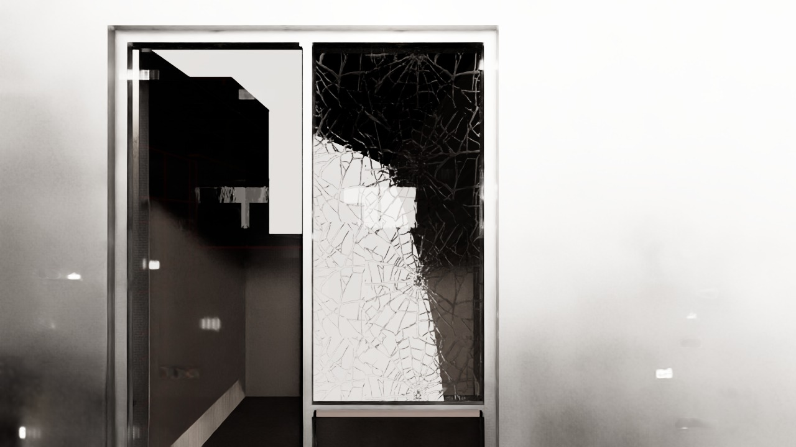

# From Revit to Robot: BIM-Driven Digital Twin for Autonomous Building Operations

<p align="center">
  
</p>
<p align="center"><sub>A simulated NVIDIA Nova Carter driving along a glass-walled corridor inside the Isaac Sim twin of the Kern Center (2× speed).</sub></p>

**Train a building's security-patrol robot before the building exists.** We turn an architect's Revit model into a physics-accurate NVIDIA Isaac Sim digital twin. Inside it we generate auto-labeled synthetic camera/LiDAR data, fine-tune a vision-language model to spot safety anomalies, and drive a Nova Carter robot on planned patrol routes with ROS 2 Nav2.

Student research project at the Milwaukee School of Engineering (MSOE). The target is the **Robert D. Kern Engineering Innovation Center**, a 97,000 sq ft building that was still under construction during this work.

## Highlights

- **BIM → USD → Isaac Sim pipeline.** Turns the Revit 2024 model into a simulation-ready twin with collision geometry, articulated doors, and semantic labels.
- **Synthetic data with free labels.** Door open/closed and glass cracked/intact frames come out of the simulator already labeled, with domain randomization (lighting, viewpoint, door families, crack styles).
- **Fine-tuned VLM** (`Qwen/Qwen3-VL-2B-Instruct` + LoRA). Trained on synthetic renders only. **97.4% / 97.2%** on held-out *synthetic* door / glass frames. **93.0%** on 100 *real* door photos from an existing campus building ([results](#results)).
- **DINOv2-based data curation.** Stratified k-means on DINOv2 embeddings picks a diverse, label-balanced training subset.
- **Autonomous patrol in the twin.** Occupancy maps → NVIDIA SWAGGER navigation graph → traveling-salesman door-inspection route → ROS 2 Nav2 drives a simulated Nova Carter with 360° LiDAR.
- **Runs headless at scale** on MSOE's **Rosie** supercomputer (SLURM; T4 and V100 GPUs).
- **Recognition:** Rosie Supercomputer Challenge 2026 finalist (5 of 27 teams) and Honorable Mention. Co-authored a paper published at MICS 2026.
  <!-- TODO(Adrian): add the MICS 2026 paper title + link, and a Rosie Challenge link if public. -->

---

## Demos

<table>
  <tr>
    <td width="50%"></td>
    <td width="50%"></td>
  </tr>
  <tr>
    <td><sub><b>Articulated doors.</b> A door from the Revit model swinging on its hinge in the twin.</sub></td>
    <td><sub><b>Physics check.</b> Balls dropped onto the twin's ground floor land, bounce, and settle.</sub></td>
  </tr>
  <tr>
    <td></td>
    <td></td>
  </tr>
  <tr>
    <td><sub><b>Robot in the twin.</b> Nova Carter driving past a box obstacle, live in the Isaac Sim viewport (1.5× speed).</sub></td>
    <td><sub><b>Costmap navigation.</b> The robot (green) follows its planned path (red) across a floor's occupancy map (4× speed).</sub></td>
  </tr>
  <tr>
    <td></td>
    <td></td>
  </tr>
  <tr>
    <td><sub><b>Dijkstra routing.</b> Shortest path (yellow) between a START and an END node on the auto-generated navigation graph (3× speed).</sub></td>
    <td><sub><b>Patrol planning.</b> The navigation graph becomes a numbered traveling-salesman tour from a START node (3× speed).</sub></td>
  </tr>
</table>

<!-- TODO(Adrian): link full video "Video_Submission_Digital_Twin.mp4" (~21 min project presentation) once it is on YouTube. -->
<!-- TODO(Adrian): optionally link full-length "CostMapNavigation.mp4", "Djikstras Algo.mp4", "TSP-Video.mp4" if uploaded. -->

---

## How it works

```
Revit model ──► USD ──► Isaac Sim twin ──► labeled camera frames ──► fine-tuned VLM
                              │                                          │
                              └──► occupancy maps ──► patrol route ──► Nav2 robot
```

### 1. Build the twin

- **Revit to USD.** MSOE's architects gave us the Kern Center model in Revit 2024. We export it to USD and keep only what the robot needs: walls, floors, doors, stairs. Then we add collision geometry and physics materials. See [`revit_to_usd.py`](revit_to_usd.py) and [`assets/environments/InnovationCenter/`](assets/environments/InnovationCenter/README.md).
- **Doors that move.** Each hinged door becomes a revolute joint. The robot sees doors at many angles, and every frame is labeled automatically.
- **Occupancy maps.** We ray-trace each floor of the twin to get the grid maps Nav2 uses. See [`floorplan_vision/`](floorplan_vision/README.md).

### 2. Teach a VLM to spot problems

- **Synthetic frames.** The robot's camera records doors and glass panels under random lighting and viewpoints. Cracked glass comes from swapping generated crack materials onto random panels. See [`SyntheticDataGen/cracked_glass/`](SyntheticDataGen/cracked_glass/README.md).
- **Pick a varied training set.** We embed every frame with DINOv2 and run k-means inside each label group. Keeping the frame closest to each cluster center gives varied images and an exact 50/50 class split. See [`curate_diversity.py`](SyntheticDataGen/cracked_glass/curate_diversity.py).
- **Fine-tune.** We started with Qwen2-VL and moved to **Qwen3-VL-2B-Instruct**, which had the best zero-shot score of the small VLMs we tried. LoRA plus the vision projector trains about 1.6% of the weights. One model answers one question with four answers: door open, door closed, glass cracked, glass intact. See [`vlm/qwen3vl_unified_lora_v4/`](vlm/qwen3vl_unified_lora_v4/USAGE.md).
- **What went wrong first.** Our first dataset used one door. The model scored high on it and **0%** on a door it had never seen, because it had memorized that one door. We rebuilt the data across 8 doors and several Revit door families, and held some doors out for testing.

<p align="center">
  
</p>
<p align="center"><sub>A synthetic cracked-glass panel from the training data.</sub></p>

### 3. Patrol

- **Why.** Campus security officers walk the halls to check that doors are locked and glass is intact. MSOE Public Safety told us these two checks matter most.
- **Robot.** A simulated **NVIDIA Nova Carter** ("ROSCOE") with 360° LiDAR and a camera.
- **Route.** NVIDIA SWAGGER builds a navigation graph on each floor map. The graph node closest to each door becomes a stop. Dijkstra gives the walking distance between every pair of stops. A traveling-salesman tour visits all of them: greedy nearest-neighbor, then 2-opt, best of 10 random starts. See [`floorplan_vision/visualize_door_tsp.py`](floorplan_vision/visualize_door_tsp.py).
- **Driving.** **ROS 2 Nav2** follows the route and steers around obstacles using LiDAR. See [`navigation/`](navigation/README.md). An earlier version used a reinforcement-learning policy. We switched to Nav2 because it was quicker to make reliable. The RL code is archived in [`training/`](training/) and on the `archive/rl-building-finetune` branch.
- **Goal.** MSOE Public Safety estimated that automating routine patrols could save about **3,000 officer-hours a year**.
  <!-- TODO(Adrian): confirm the ~3,000 officer-hours/yr figure and how it was derived. It is not documented in this repo. -->

<p align="center">
  
</p>
<p align="center"><sub>Floor 4 of the Kern Center: occupancy map with the auto-generated navigation graph (red nodes, blue edges).</sub></p>

---

## Results

> **Read this first:** the "held-out" door and glass numbers are on **simulated (synthetic) images**. The real-world number is a small 100-photo door test. Navigation results have not been tabulated yet.

| Test set | n | Zero-shot | Fine-tuned |
|---|---|---|---|
| Door, held-out frames (**synthetic**) | 4,472 | — | **97.4%** |
| Glass, held-out frames (**synthetic**) | 810 | — | **97.2%** |
| Door, held-out door instance / swing (**synthetic**) | 7,776 | 84.1% | **90.2%** |
| Real-world door photos (Diercks Hall, MSOE) | 100 | — | **93.0%** |

- Real-world door test: closed 100%, open 88.3%. Diercks Hall is an existing MSOE building from the same architect, with the same design language.
- Scale: the pipeline was applied to a six-building digital campus, using over 3,500 GPU jobs and about 2,000 GPU-hours on Rosie.
<!-- TODO(Adrian): add Nav2 patrol metrics (route completion, collisions, time per tour) once tabulated. -->

---

## Team

MSOE student research group, led by **Adrian Manchado** through the MSOE AI Club.

Adrian Manchado (lead) · Owen Pacetti · Steven Thomas · Joseph Loduca · Nicolas Picha · Tanner Cellio · Diego Gonzalo · Delsoro Some

Built in coordination with MSOE's Public Safety Office, on MSOE's Rosie supercomputer.
<!-- TODO(Adrian): add a faculty advisor name, if you want to credit one. -->

---

## What's next

- **Sim-to-real on a physical Nova Carter.** Run the same SWAGGER + TSP + Nav2 patrol on real hardware, supervised by Public Safety.
- **Wider real-image validation.** Test the VLM on more real photos: cracked/intact glass (not yet tested on real images), more buildings, and harder lighting.
- **Navigation metrics.** Report route-completion and obstacle-avoidance results for Nav2 in the twin.
- **More anomaly types.** Hallway obstructions and irregular room states.
- **The Kern Center itself.** Re-run the pipeline once the building opens, and compare twin and real data.

---

## Repository map

```
revit_to_usd.py               Revit/IFC → USD conversion entry point
assets/environments/          Building USDs (Git LFS), occupancy maps, nav graphs
floorplan_vision/             Occupancy maps, auto nav graph, door → node mapping, TSP visuals
navigation/                   ROS 2 Nav2 package: params, launch, orchestrator, TSP demo recording
SyntheticDataGen/             Cracked-glass synthetic data + DINOv2 curation
simulations/                  Isaac Sim scenes: environment checks, robot + door data collection
vlm/                          Fine-tuned Qwen3-VL LoRA adapter card + usage
training/                     Archived RL navigation experiments (superseded by Nav2)
sim_utils/                    Shared helpers (follow camera, ffmpeg video capture)
docs/                         Pipeline notes; docs/media/ holds the demo GIFs above
DEVELOPMENT.md                Developer guide: Isaac Sim on Rosie, WebRTC streaming
submit_*.sh                   SLURM job scripts for Rosie
```

> The large `.usd` building models are stored with **Git LFS**. Run `git lfs install` before cloning.

An early 10-second demo (Nova Carter in the stock Isaac Sim hospital scene, from before the Kern Center twin) is at [`assets/demos/hospital_follow_cam_10s.mp4`](assets/demos/hospital_follow_cam_10s.mp4).

---

## Developing

Everything runs on NVIDIA Isaac Sim 5.1, headless on MSOE's Rosie cluster (SLURM) or streamed to a local GUI over WebRTC.
Setup, job submission, streaming, and troubleshooting are in **[DEVELOPMENT.md](DEVELOPMENT.md)**.

